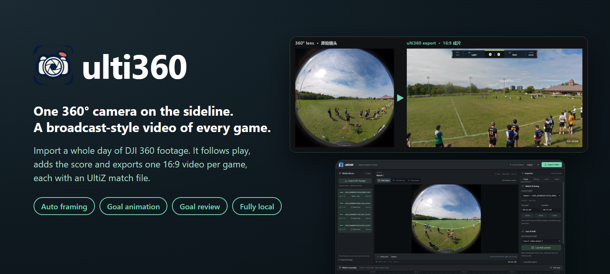
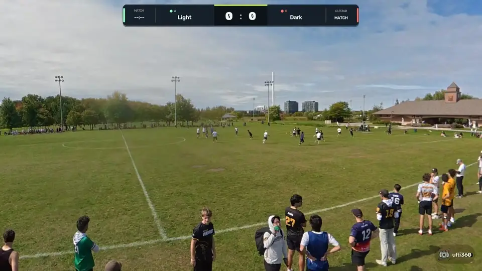
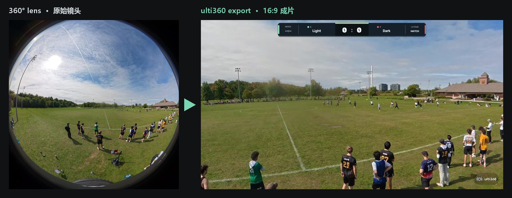
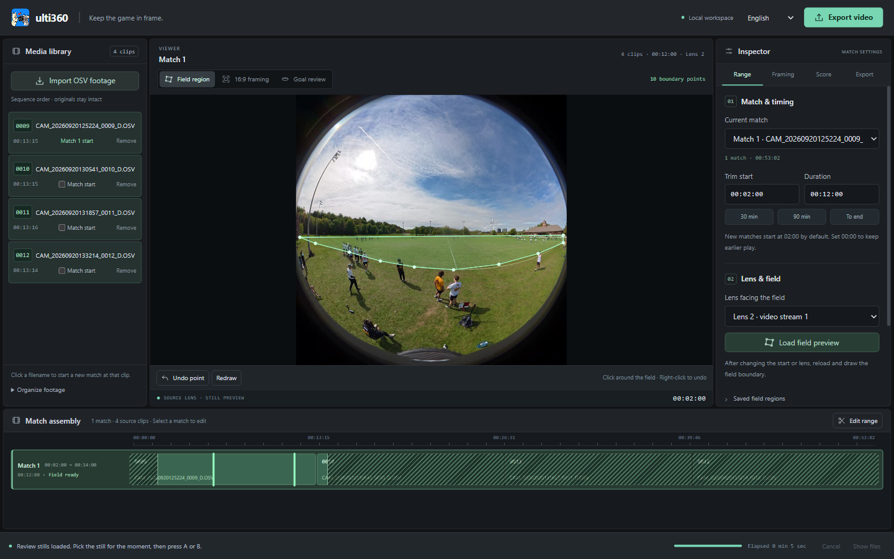
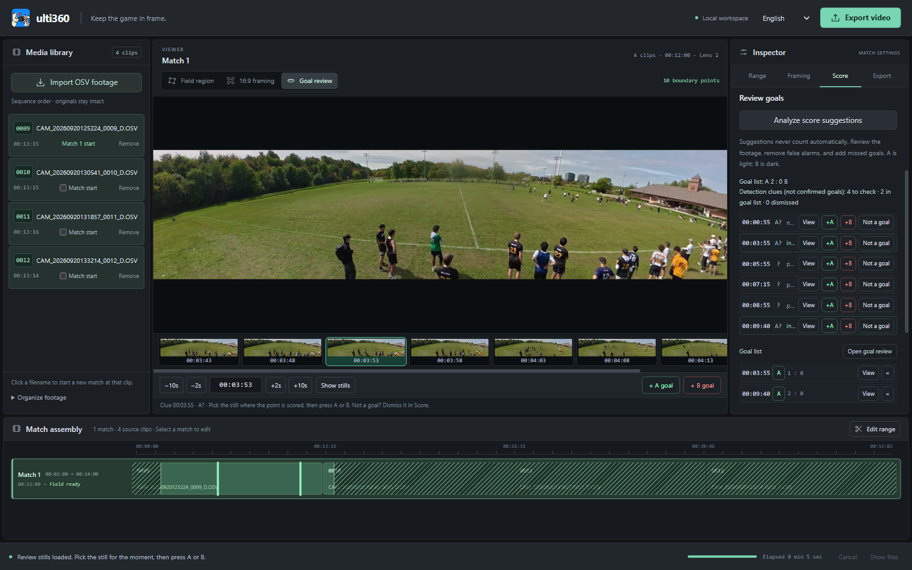

<div align="center">

<a href="https://github.com/stevensun1005/ulti360-downloads/releases"></a>

[](https://github.com/stevensun1005/ulti360-downloads/releases)
[](https://github.com/stevensun1005/ulti360-downloads/releases/download/v0.14.0-beta.1/ulti360-Windows.zip)
[](https://github.com/stevensun1005/ulti360-downloads/releases/download/v0.14.0-beta.1/ulti360-macOS-arm64.zip)
[](#faq)
[](#faq)

<h3>
  <a href="https://github.com/stevensun1005/ulti360-downloads/releases/download/v0.14.0-beta.1/ulti360-Windows.zip">⬇️ Download for Windows</a>
  &nbsp;·&nbsp;
  <a href="https://github.com/stevensun1005/ulti360-downloads/releases/download/v0.14.0-beta.1/ulti360-macOS-arm64.zip">⬇️ Download for Mac</a>
</h3>

[**First match in 4 steps →**](#first-match) · [**Install notes →**](#download) · [FAQ](#faq) · **English** · [中文](README.md)

</div>

---

After a day of games, someone always has to look after the camera. Even with a 360° camera on the sideline, you come home to a memory card full of `.OSV` clips: every frame is two fisheye circles, nothing tells you which clips belong to which game, and finding how that point got broken means scrubbing through one clip after another.

**ulti360** is a desktop app made for exactly this footage. Import a whole day of DJI 360 clips, click where each match starts, and you get one ordinary 16:9 video per match that follows the players, with the score, the clock and a goal animation on screen. It all runs on your own computer: nothing is uploaded and no account is needed.

## Real exports

| [](assets/demo.webp) | [](assets/before-after.jpg) |
| :--- | :--- |
| **A real export, unedited**<br>ulti360 framed the 360° footage, followed play and added the scoreboard and the goal animation. | **Same moment, before and after**<br>Left: the camera's raw 360° lens. Right: the 16:9 export. |

## What it does

### Framing: one camera, the whole game in view

- One raised 360° camera, fixed near the middle of a sideline, sees the whole field. No camera operator.
- The app finds the people on the field and pans a steady 16:9 view to follow where they are and how they move, with no dizzy zooming.
- It follows players, not the disc: it never detects the disc itself, and still keeps the point in frame.
- **Natural wide** at 100° is the default; 120° shows more, 60–90° gives tighter views, and **Linear perspective** is there too. The angle you pick stays fixed for the whole export.
- Before exporting you can check three still 16:9 previews, **Center**, **Left** and **Right**, made with the export engine's own projection.

### Matches: a whole day of footage, one video per match

- Import up to 200 `.OSV` clips at once. They sort by the `00xx` number at the end of the filename, whatever order you picked them in.
- Click the first filename of each match to mark its start. Markers on `0001`, `0004` and `0008` make `0001–0003`, `0004–0007` and `0008–last`.
- When a match's first clip is at least 2:01 long, the first two minutes are skipped by default for tripod setup; set **Trim start** to `00:00:00` to keep them.
- Two matches in one file? **Split into two matches** at an offset; the later match does not lose another two minutes.
- If the camera's numbering started over, use **Top**, ↑ and ↓ to restore the order you filmed in.
- Duplicate clip numbers block export, and overlapping recording times need your confirmation after you look at the clips.

### Field: a few clicks to show it where the field is

- On the lens that faces the game, click 3–50 points around the field. Keep players' feet inside; leave spectators, benches and neighbouring fields outside where you can.
- Fix mistakes with **Undo point** or **Redraw**.
- A region you checked can be reused at the same camera position, but look at it for every match; redraw after moving the camera, changing lens or changing the trim start.
- Optional **Field calibration**: click the four corners and the two end-zone lines in order, and the export carries field positions in metres.



<sub>The workspace: the media library marks where each match starts, the field is drawn on the 360° lens, the inspector sets range and lens, and the match timeline runs along the bottom.</sub>

### Score: a broadcast-style scoreboard that shows only goals you confirmed

- Turn on the overlay in **Score** and enter both team names (up to 20 Latin characters each). The video shows team names, the score, a match clock and a goal animation.
- **Goal review**: enter a time, choose **Show stills** to see eight whole-field panoramas around it, pick the one where the point is scored and press A or B. ← / → move between stills; ±2 s and ±10 s step the time.
- **Analyze score suggestions** lists likely goals from player movement. **View** opens one in Goal review; then add it for A, for B, or mark it **Not a goal**. During analysis A is light jerseys and B is dark.
- The **Goal list** shows the running score, switches a goal's team and removes entries; every goal also appears as a coloured tick on the match timeline.
- If you know the official final score, enter it to check how many goals you have.
- The clock starts at the estimated opening pull (or an offset you type) and runs continuously, timeouts included; when the opening pull is not visible it shows `--:--`.

Already kept score on paper or somewhere else? Use **Edit as text**, one goal per line, timed from 00:00 of the trimmed export:

```text
04:31 A
09:02 B
13:47 A
```



<sub>Goal review: eight whole-field stills across the middle, suggested goals and the goal list on the right, confirmed goals marked on the timeline.</sub>

### Export: one MP4 per match, ready to upload

- Pick a folder on your computer. Matches export one after another, with progress and **Cancel** always visible.
- Each match gets an MP4, a companion JSON and an UltiZ match file (`.ultiz.json`) holding the confirmed points, scoring teams and clock, ready for UltiZ, the team stats app.
- 1920 × 1080 at 25 fps by default; 720p, 2K (2560 × 1440), 4K (3840 × 2160) and 50 fps are available. Every video has a small ulti360 watermark in the lower-right corner.
- Source audio comes along as AAC when there is any.
- Encoding: on Windows, **Auto** currently uses x264; on Apple Silicon it tries HEVC VideoToolbox, then H.264 VideoToolbox, then x264. The encoder actually used is written in the result and the JSON.
- For a quick look, set **Projection quality** to **Fast** and export a short stretch.

### Local: your footage stays with you

- Everything is processed on your computer. No upload, no account, no internet needed.
- Windows has a GPU path (ONNX Runtime DirectML); on Mac, person detection uses Core ML.
- The interface comes in English and 中文.
- Clips on a mapped network drive (NAS) keep their correct durations.
- Videos, images and data you export with ulti360 belong to you.

## What's new in 0.13

- **Goal review.** Jump to any moment, see eight whole-field stills, and add the goal with **A** or **B**. Suggested goals open with one click, so there is no more hunting for timestamps in another player.
- **Field calibration** *(optional)*. Click four corners and two end-zone lines to map the field in metres.
- **UltiZ match file.** Every export writes a `.ultiz.json` with confirmed points, scoring teams and the clock.
- **NAS-friendly.** Clips on a mapped network drive keep their durations.

Notes for every version are on the [Releases](https://github.com/stevensun1005/ulti360-downloads/releases) page; the notes for the 0.12.0 Beta 2 FFmpeg distribution repair are in [RELEASE-NOTES.md](RELEASE-NOTES.md).

## <a id="first-match"></a>Your first match in 4 steps

| Step | What you do |
|---|---|
| **1. Import** | Drop in the day's `.OSV` clips. They sort themselves by clip number. |
| **2. Mark matches** | Click the first clip of each match. The first two minutes are trimmed for tripod setup. |
| **3. Draw the field** | Click around the field on the lens that faces the game, then preview the 16:9 view. |
| **4. Export** | Pick a folder. Each match becomes its own MP4, ready for YouTube. |

## <a id="download"></a>Download and install

### System requirements

- **Windows**: x64.
- **Mac**: Apple Silicon, macOS 13 or later. Intel Macs are not supported.
- **Camera**: a DJI 360 camera that records dual-lens `.OSV` files.
- **Disk**: copy the day's original clips to a local disk, and choose an output folder with room for the MP4s and temporary render files. Keep the originals until you have checked the exports.
- No Python, Node or FFmpeg install is needed.

### Download

| Platform | Version | Download | Install |
|---|---|---|---|
| **Windows** x64 | 0.14.0 Beta | [**ulti360-Windows.zip**](https://github.com/stevensun1005/ulti360-downloads/releases/download/v0.14.0-beta.1/ulti360-Windows.zip) | Extract the whole folder and open `ulti360.exe`. Keep `resources` beside it. |
| **Mac** Apple Silicon, macOS 13+ | 0.14.0 Beta | [**ulti360-macOS-arm64.zip**](https://github.com/stevensun1005/ulti360-downloads/releases/download/v0.14.0-beta.1/ulti360-macOS-arm64.zip) | Extract and move `ulti360.app` to `/Applications`. |

### First launch

- Both apps are the same 0.14.0 release.
- Download the app ZIP from the table, not GitHub's "Source code" archive, which holds only this page. ZIPs in a Release whose names contain `corresponding-source` hold third-party source code; they are not the app either.
- **Mac**: the app is ad-hoc signed, not notarized. If macOS blocks it, follow [Apple's steps for opening an app](https://support.apple.com/en-ca/102445).
- **Windows**: Windows may show a download warning for a new app.

## Filming tips

- **Go high.** Raise the camera as high as you safely can near midfield. Height means fewer hidden players.
- **Start before the pull.** The first two minutes of a match are trimmed by default; set **Trim start** to `00:00:00` to keep them.
- **Keep the camera still.** After it moves, tilts, changes lens or changes position, draw the field again.
- **Contrasting jerseys** help score suggestions tell the teams apart: A is light, B is dark.
- **Try a short export first** to check coverage, sharpness and sound.

## Why the score never guesses

- Suggested goals never count on their own. Only goals you confirm in Goal review appear on the scoreboard.
- The app cannot see the disc or judge a legal catch, so the final score is always the one you reviewed.
- Clips are joined end to end; time that was not recorded is not filled in.
- Changing the clip order or which clips make up a match clears old score suggestions and goal times, and they need analysing and reviewing again.
- Duplicate clip numbers block export; overlapping recording times need your confirmation, and confirming does not quietly remove the overlapping seconds.
- The clock is continuous elapsed time, timeouts included; when the opening pull is not visible it shows `--:--` instead of guessing.
- Natural wide reduces stretching at the edges, but it cannot add detail the lens did not record, and neither can a 4K export.
- The encoder actually used, and any fallback, is written in the export result and the JSON.
- This is a beta: full-match and all-day validation of the current version is still in progress.

## <a id="faq"></a>FAQ

<details>
<summary>Which cameras work?</summary>

DJI 360 cameras that record dual-lens `.OSV` files. Mount the camera raised and fixed near the middle of a sideline.

</details>

<details>
<summary>Is the score automatic?</summary>

ulti360 *suggests* goals from player movement, and you confirm each one in Goal review before it appears on screen. It cannot see the disc or judge a legal catch, so the final score is always the one you reviewed.

</details>

<details>
<summary>Does it track the disc?</summary>

No. The view follows where the players are and how they move, which keeps the play in frame without seeing the disc itself. Disc detection is still research (see Research, not in the app yet) and is not in the app.

</details>

<details>
<summary>Do I need the internet or an account?</summary>

No. Video processing runs entirely on your computer.

</details>

<details>
<summary>What output can I get?</summary>

1080p by default, plus 720p, 2K and 4K, at 25 or 50 fps. Each export has a small ulti360 watermark in the corner.

</details>

<details>
<summary>Does it run on an Intel Mac?</summary>

No. The Mac app needs Apple Silicon and macOS 13 or later.

</details>

<details>
<summary>Can I use it for my club or for paid work?</summary>

Yes, from 0.13 on: the [ulti360 License](LICENSE-ulti360.md) allows any use of official releases, including commercial. Redistribution (other than sharing an unmodified official package), modification and removing the watermark need permission. 0.12.0 and earlier keep [PolyForm Noncommercial](LICENSE.md).

</details>

<details>
<summary>Where do I report a problem?</summary>

[Open an issue](https://github.com/stevensun1005/ulti360-downloads/issues) with the app version, your OS/chip, the error text, and clip numbers. Logs are at `%APPDATA%\ulti360\logs\ulti360.jsonl` (Windows) or `~/Library/Application Support/ulti360/logs/ulti360.jsonl` (Mac). Check them for paths or team names before sharing, and never post private footage.

</details>

## Development and verification

The app's own source code is not public. What this repository does publish is the build recipe and source records for the FFmpeg that ships with it, so anyone can rebuild that FFmpeg:

```bash
# From this repository's root: rebuild the export FFmpeg 7.1 + x264
bash ffmpeg/build.sh windows   # Windows: MSYS2 UCRT64 GCC, make, pkgconf, NASM, Python
bash ffmpeg/build.sh macos     # Apple Silicon: Xcode command-line tools

# From a Release's ffmpeg-corresponding-source ZIP: extract it, then from its root
bash build/build.sh <platform>
```

- `ffmpeg/sources.json` locks FFmpeg 7.1 and x264 to source archives and SHA-256 values; x264 is the only external library enabled, and autodetection and network input are off.
- The build inspects runtime imports and rejects untracked non-system libraries; each platform produces a binary ZIP, a corresponding-source ZIP, a manifest and checksums.
- Source and binary hashes identify the delivered pair; byte-identical reproduction across different compilers or signatures is not claimed.
- For the FFmpeg libraries used by Electron playback and OpenCV video reading, see [runtime-sources](runtime-sources/README.md); to rebuild the Mac libraries, extract the runtime corresponding-source ZIP, copy its archives/ files to runtime-build/archives/, then run `python build/build.py` (native Apple Silicon, Python 3.13, Xcode command-line tools).
- For the 0.12.0 Beta 2 distribution repair, both packaged engines passed a real test: a synthetic dual-lens OSV exported to a 25-frame 720p H.264/AAC MP4, followed by a full decode; the reports record the actual encoders and the source and signing hashes.
- Functional, signing and source-delivery checks are not a legal certification, nor a measure of match-recognition accuracy.

Details: [ffmpeg/README.md](ffmpeg/README.md).

## Research, not in the app yet

These are things we have built and measured in research. **None of them is in the app you can download today (0.14.0):** the app does not detect the disc, read numbers or identify players, and the exported score still uses only the goals you confirmed. The figures come from other people's games that were not used for training; they are research results, not the app's accuracy.

- **Teams split by shirt colour, person by person.** The people on the field are sorted into two teams by shirt colour; anyone it cannot place is marked "team uncertain". (The app's score suggestions already tell light shirts from dark ones, A and B; this per-person version, used to split tracked players into two teams, is not in 0.14.0.)
- **Jersey numbers read from video.** 16 small windows are cut from each person box; a read counts when at least 3 windows agree on the same 1-2 digit number at confidence 0.9 or more, and a person needs 2 agreeing reads before the number counts. On the indoor benchmark (81 readable numbers, 27 players) it read 36 right and 1 wrong and named 18 players; the more conservative rule (confidence 0.99) read 28 right and 0 wrong and named 16 players. On 211 readable crops from other games: 107 right, 5 wrong, plus 7 false reads where there was no number. Players with no number get a steady letter label (such as "Light B"); a letter can move between teammates, a number never does.
- **The disc, and who has it.** On broadcasts it had not seen, at threshold 0.5, it finds about 55% of the discs at about 51% precision. About half the discs are still missed, and the "who has the disc" label is built on it, so that is not reliable either.
- **Goals marked without a scoreboard.** Only the disc and the players are used. A catch, then the disc stays dead (held still or set down, no throws) for at least 8 seconds while players walk: the goal is marked at the catch, and the team that held the disc is the scoring team. On a 15.5-minute broadcast of another game (panning camera; the on-screen score used only as the answer key, never as input) it found 8 of 12 real goals and got the scoring team right on 6 of those 8. It missed 4, and made 1 false mark (probably one of the missed goals, marked 9 seconds late). Marks fell 0.3 to 8 seconds before the score changed (median 2.7 s) and 1-3 seconds after the catch seen by eye. On a 2-minute clip inside it, both goals were found, with no misses and no false goals. The limit is the disc detector: a goal where the disc was never seen is missed. This is one stretch, a small sample, and every goal would still need a person to confirm it.
- **Shared colours and thin boxes.** In the research overlay videos the two teams always use light blue and pink; yellow means only "team uncertain", grey means off the court, and red is kept for the disc alone. Boxes are thin: 1 px at 720p, at most 2 px at 1080p.
- **Field drawn by hand for 360 recordings.** The app already lets you draw the field by hand (see Field above). For 360 recordings we do not do automatic floor-line detection (we tried it and it picked up wrong lines). The plan is to use your hand-drawn field to decide who is on court; that step is only planned and not built yet.

## Research models

The three models behind this research (a disc detector, a jersey-number reader and a person re-identification embedding) are published as a **pre-release** at the [indoor-models-2026-11-22 release](https://github.com/stevensun1005/ulti360-downloads/releases/tag/indoor-models-2026-11-22). They are research weights only, and **the app does not use them**. They were fine-tuned on other people's public indoor ultimate game videos; those videos, frames and labels are not distributed. The disc and number weights start from Apache-2.0 models; the re-identification weights start from pre-trained weights that allow non-commercial research only, so they are for non-commercial research only. All three were trained on third-party videos; for commercial use, retrain on your own footage. On games it had not seen, the re-identification embedding's most similar other crop is the same person 83.7% of the time (76.2% for the original model), so use it only to suggest, because merging automatically makes too many wrong merges. Full benchmarks and licences: [MODELS.en.md](https://github.com/stevensun1005/ulti360-downloads/releases/download/indoor-models-2026-11-22/MODELS.en.md).

## Licence and third-party software

- **ulti360 0.13 and later**: [ulti360 License](LICENSE-ulti360.md). Official releases may be used for any purpose, including commercial; redistribution (other than sharing an unmodified official package), modification and removing the watermark need permission. The videos and data you export are yours.
- **0.12.0 and earlier**: [PolyForm Noncommercial 1.0.0](LICENSE.md). Anyone who received those releases keeps the rights that licence gave them.
- **Third-party components**: FFmpeg, x264, Electron, OpenCV, ONNX Runtime and YOLOX keep their own terms, and the ulti360 License does not limit the rights those licences give you. The full list is in the [third-party notices](THIRD-PARTY.md).

### FFmpeg corresponding source

- The export FFmpeg 7.1-ulti360.1 and x264 are licensed under GPL-2.0-or-later and run as a separate process. Every Release includes a platform-specific **ffmpeg-corresponding-source** ZIP beside the app ZIP: the exact source archives, their SHA-256 values, the licence texts, the configure command, build scripts, and compiler and dependency records.
- The [FFmpeg build Release](https://github.com/stevensun1005/ulti360-downloads/releases/tag/ffmpeg-7.1-ulti360.1) also hosts the source and raw binaries, and the [public build recipes](https://github.com/stevensun1005/ulti360-downloads/tree/main/ffmpeg) document reproduction. Inside the app, `resources/licenses/ffmpeg-ulti360/source-manifest.json` links the shipped executable to its corresponding source.
- Source for the FFmpeg libraries used by Electron playback and OpenCV video reading is in **runtime-ffmpeg-corresponding-source-1.zip**, included with the app Release, and in the [runtime build Release](https://github.com/stevensun1005/ulti360-downloads/releases/tag/runtime-ffmpeg-1). On Mac, OpenCV uses our own LGPL-2.1-or-later FFmpeg 7.1.1 shared libraries, with no optional external codecs.
- LGPL libraries can be replaced at their original paths, and you may reverse engineer the application as necessary to debug your modifications to those libraries; the project licence does not restrict that right. A modified Mac app must be re-signed locally, and original notices and the applicable library licences must be kept.

Original match footage is not included with the project; video processing runs locally. This project does not imply an affiliation with DJI, Blackmagic Design or Megvii.
