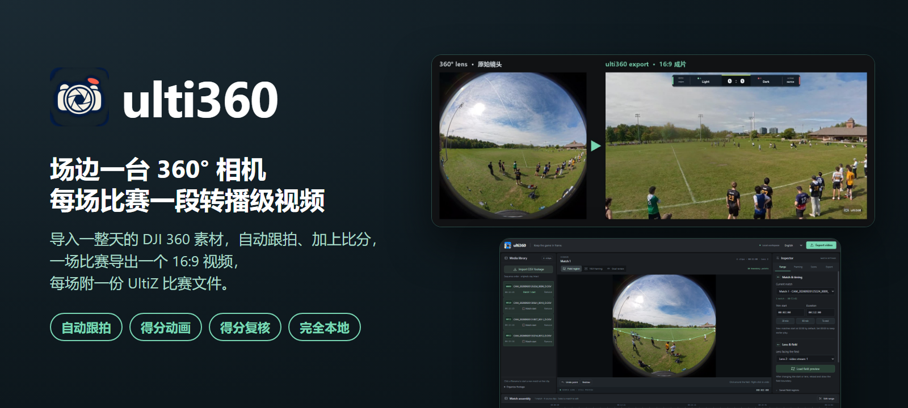
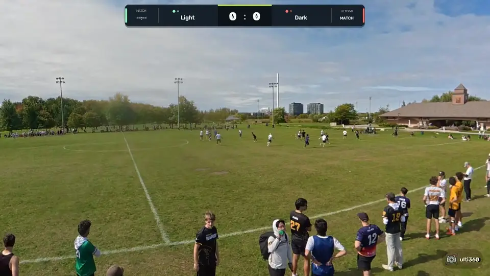
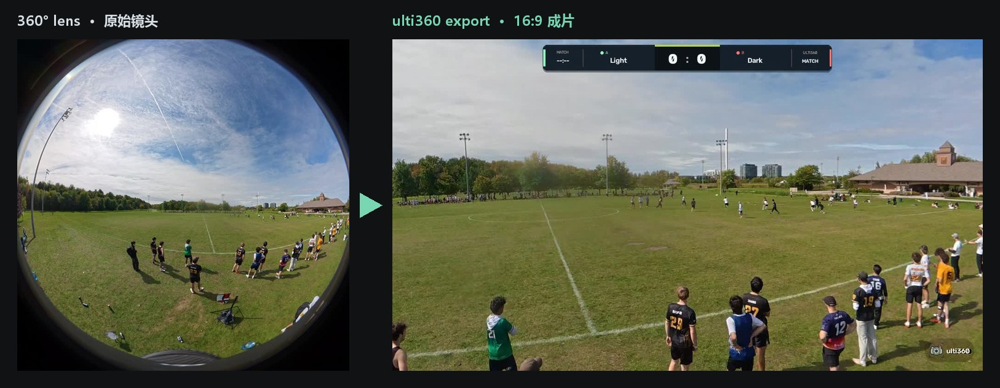
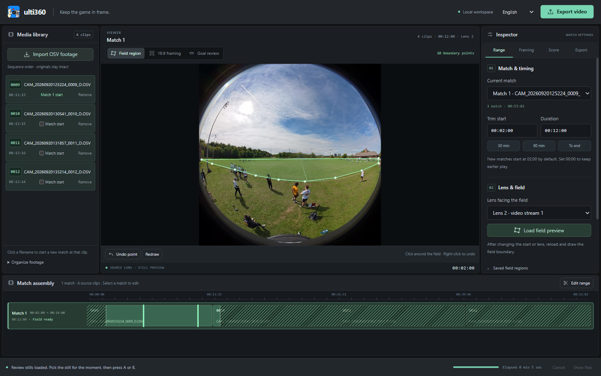
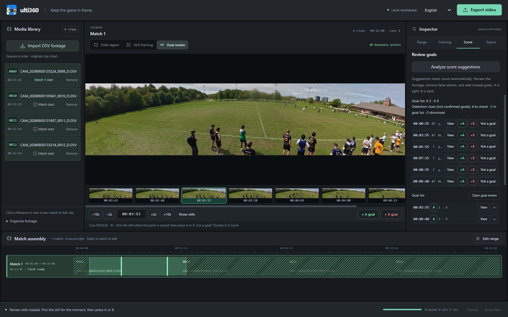

<div align="center">

<a href="https://github.com/stevensun1005/ulti360-downloads/releases"></a>

[](https://github.com/stevensun1005/ulti360-downloads/releases)
[](https://github.com/stevensun1005/ulti360-downloads/releases/download/v0.13.1-beta.1/ulti360-Windows.zip)
[](https://github.com/stevensun1005/ulti360-downloads/releases/download/v0.13.1-beta.1/ulti360-macOS-arm64.zip)
[](#faq)
[](#faq)

<h3>
  <a href="https://github.com/stevensun1005/ulti360-downloads/releases/download/v0.13.1-beta.1/ulti360-Windows.zip">⬇️ 下载 Windows 版</a>
  &nbsp;·&nbsp;
  <a href="https://github.com/stevensun1005/ulti360-downloads/releases/download/v0.13.1-beta.1/ulti360-macOS-arm64.zip">⬇️ 下载 Mac 版</a>
</h3>

[**四步做出第一场 →**](#first-match) · [**安装说明 →**](#download) · [常见问题](#faq) · **中文** · [English](README.en.md)

</div>

---

打一天比赛，场边总得有人管相机。就算架了一台 360° 相机，回来存储卡里也是一长串 `.OSV` 片段：画面是两个鱼眼圆圈，哪几段属于哪一场得自己对；想回看那一分是怎么被 break 的，只能拖着进度条一段一段找。

**ulti360** 是专门处理这种素材的桌面软件。把一整天的 DJI 360 片段导进去，点一下每场的开头，它就给每场导出一段普通的 16:9 视频：画面跟着场上的人走，比分、计时和得分动画叠在上面。全部在你自己的电脑上跑，不上传，不用注册。

## 真实成片

| [](assets/demo.webp) | [](assets/before-after.jpg) |
| :--- | :--- |
| **真实导出，没有剪辑**<br>360° 素材由 ulti360 自动取景、跟着比赛走，比分条和得分动画也是它加的。 | **同一时刻，前后对比**<br>左边是相机里的 360° 原始镜头，右边是导出的 16:9 成片。 |

## 它会帮你做什么

### 跟拍：一台相机，整场都在画面里

- 一台架高的 360° 相机固定在边线中间附近，整片场地都拍得到，不需要摄像师。
- 软件识别场上的人，按大家的位置和移动平稳转动 16:9 画面，不乱变焦，不晃眼。
- 它跟的是人，不是飞盘：不识别飞盘本身，也能让这一分留在画面里。
- 默认「自然广角」100°；想更宽选 120°，想更近有 60–90°，也可以换成「线性透视」。选好的视角整场固定。
- 导出前可以看「中央」「左侧」「右侧」三张 16:9 静态预览，用的是导出引擎同一套投影。

### 分场：一整天的素材，一场一个视频

- 一次最多导入 200 段 `.OSV`，按文件名末尾的 `00xx` 编号自动排序，跟你选文件的顺序无关。
- 点每场第一段的文件名，就标出了开场。比如标在 `0001`、`0004`、`0008`，就分成 `0001–0003`、`0004–0007`、`0008–最后一段`。
- 每场第一段至少 2:01 时，默认跳过前两分钟，那是架三脚架的时间；想保留就把「剪辑起点」设为 `00:00:00`。
- 两场录进了同一个文件，用「拆成两场」按偏移切开，后一场不会再被剪掉两分钟。
- 相机编号中途从头开始了，用「置顶」、↑、↓ 调回拍摄顺序。
- 编号重复会挡住导出；录制时间有重叠时，要你看过素材再单独确认。

### 圈场地：点几下，告诉它哪里是场

- 在朝向比赛的镜头上沿场地边界点 3–50 个点。球员的脚要圈在里面，观众、替补席和隔壁场尽量圈在外面。
- 点错了用「撤销一点」或「重画」。
- 同一个机位圈好的区域可以复用，但每场都看一眼；相机动过、换了镜头或改了剪辑起点，就重新圈。
- 可选的「场地校准」：按顺序点四个场角和两条端区线，导出的文件就带上以米为单位的场地坐标。



<sub>工作台：左边素材库标出每场开头，中间在 360° 镜头上圈出场地，右边设置时段和镜头，下面是场次时间轴。</sub>

### 比分：转播级比分条，只显示你确认过的分

- 在「比分」里打开叠加，填两队队名（各最多 20 个拉丁字符）。画面上有队名、比分、比赛计时和得分动画。
- 「得分复核」：输入一个时间，点「显示前后画面」，看这一刻前后八张全场全景，选中得分那一张，按 A 或 B 记一分。← / → 换画面，±2 秒、±10 秒挪时间。
- 「分析得分建议」根据人员移动列出可能的得分。「查看」直接在得分复核里打开，然后记给 A、记给 B，或者点「不是得分」。分析时 A 队是浅色球衣，B 队是深色。
- 「得分记录」显示实时比分，可以改得分方、删掉某一分；每一分在场次时间轴上都有彩色刻度。
- 知道官方终场比分就填上，用来核对记了几分。
- 计时从估计的第一次开盘（或你手填的偏移）开始，连续计时，暂停也算在内；拍不到开盘时显示 `--:--`。

已经在纸上或别的地方记好了？用「以文本编辑」一行写一分，时间从剪辑后成片的 00:00 算起：

```text
04:31 A
09:02 B
13:47 A
```



<sub>得分复核：中间一排是前后八张全场画面，右边是得分建议和得分记录，时间轴上标着已记的分。</sub>

### 导出：每场一个 MP4，拿去就能传

- 选一个本机文件夹，各场依次导出，进度和「取消」一直看得见。
- 每场得到一个 MP4、一个配套 JSON 和一个 UltiZ 比赛文件（`.ultiz.json`）。比赛文件里是已确认的得分、得分方和计时，可以导入球队数据应用 UltiZ。
- 默认 1920 × 1080、25 fps；也能选 720p、2K（2560 × 1440）、4K（3840 × 2160）和 50 fps；每段视频右下角带一个小的 ulti360 水印。
- 原片有声音就一起导出（AAC）。
- 编码：Windows 的「自动」目前用 x264；M 芯片 Mac 依次尝试 HEVC VideoToolbox、H.264 VideoToolbox、x264。实际用了哪个，结果和 JSON 里都写着。
- 想先看效果，「投影画质」选「快速」，导一小段试试。

### 本地：素材一直在你手里

- 全程在你的电脑上处理，不上传、不注册，也不需要联网。
- Windows 有 GPU 加速路径（ONNX Runtime DirectML），Mac 的人员识别用 Core ML。
- 界面有中文和 English 两种。
- 素材放在映射的网络驱动器（NAS）上，时长也能正常读出。
- 用 ulti360 导出的视频、图片和数据都归你。

## 0.13 新功能

- **得分复核**：跳到任意时刻看八张全场画面，按 **A** 或 **B** 记分；得分建议一点就开，不用再去别的播放器里找时间。
- **场地校准**（可选）：点四个场角和两条端区线，得到以米为单位的场地坐标。
- **UltiZ 比赛文件**：每次导出附带 `.ultiz.json`，包含已确认的得分、得分方和计时。
- **支持 NAS**：从映射网络驱动器导入，时长正常显示。

每个版本的说明在 [Releases](https://github.com/stevensun1005/ulti360-downloads/releases) 页；0.12.0 Beta 2 那次 FFmpeg 分发修订的说明见 [RELEASE-NOTES.md](RELEASE-NOTES.md)。

## <a id="first-match"></a>四步做出第一场比赛

| 步骤 | 你要做的 |
|---|---|
| **1. 导入** | 拖入当天的 `.OSV`，按片段编号自动排好。 |
| **2. 分场** | 点每场的第一段。默认跳过开头两分钟，留给架三脚架。 |
| **3. 圈场地** | 在朝向比赛的镜头上沿场地边界点几下，再预览 16:9 画面。 |
| **4. 导出** | 选一个文件夹，每场生成独立的 MP4，直接传 YouTube。 |

## <a id="download"></a>下载与安装

### 系统要求

- **Windows**：x64。
- **Mac**：M 芯片（Apple Silicon），macOS 13 或更新。不支持 Intel Mac。
- **相机**：录双镜头 `.OSV` 文件的 DJI 360 相机。
- **硬盘**：把当天原片复制到本机磁盘；输出目录要放得下 MP4 和导出时的临时文件。检查完成片之前，别删原片。
- 不用另外装 Python、Node 或 FFmpeg。

### 下载

| 平台 | 版本 | 下载 | 安装 |
|---|---|---|---|
| **Windows** x64 | 0.13.1 测试版 | [**ulti360-Windows.zip**](https://github.com/stevensun1005/ulti360-downloads/releases/download/v0.13.1-beta.1/ulti360-Windows.zip) | 完整解压后打开 `ulti360.exe`，旁边的 `resources` 文件夹要留着。 |
| **Mac** M 芯片，macOS 13+ | 0.13.1 测试版 | [**ulti360-macOS-arm64.zip**](https://github.com/stevensun1005/ulti360-downloads/releases/download/v0.13.1-beta.1/ulti360-macOS-arm64.zip) | 解压后把 `ulti360.app` 移到 `/Applications`。 |

### 第一次打开

- 两个平台是同一个 0.13.1 版本。
- 请下载上表里的软件 ZIP。GitHub 自动生成的「Source code」只包含这个页面；Release 里名字带 `corresponding-source` 的 ZIP 是第三方源码，也不是安装包。
- **Mac**：软件是临时签名（ad-hoc），没有经过 Apple 公证。被系统拦住时，按 [Apple 打开应用的说明](https://support.apple.com/zh-cn/102445)操作。
- **Windows**：新软件下载时可能会出现安全提示。

## 拍摄小贴士

- **越高越好**：在中线附近尽量把相机架高，球员互相挡得越少。
- **开盘前就开始录**：每场默认跳过前两分钟；要保留就把「剪辑起点」设为 `00:00:00`。
- **相机别动**：架好后保持固定。相机移动、倾斜、换镜头或换位置后，都要重新圈场地。
- **两队球衣颜色反差大**，得分建议更容易分清队伍：A 是浅色，B 是深色。
- **先导出一小段**，看看覆盖范围、清晰度和声音。

## 比分为什么不会瞎记

- 得分建议永远不会自己算进比分。只有你在得分复核里确认过的分，才会出现在比分条上。
- 软件看不到飞盘，也判断不了接盘是否合法，所以最终比分以你的复核为准。
- 片段是首尾直接接起来的，中间没录到的时间不会被补出来。
- 改了素材顺序或场次组成，旧的得分建议和得分时间会被清掉，需要重新分析和复核。
- 编号重复时不让导出；录制时间重叠需要你确认，而且确认不会悄悄删掉重叠的那几秒。
- 计时是连续时间，包含暂停；看不到开盘时显示 `--:--`，不瞎猜。
- 自然广角能减少两侧拉伸，但补不回镜头没拍到的细节，选 4K 也一样。
- 实际用的编码器和回退情况都写在导出结果和 JSON 里。
- 这是测试版：当前版本的整场、整天验证还在进行。

## <a id="faq"></a>常见问题

<details>
<summary>支持哪些相机？</summary>

录制双镜头 `.OSV` 文件的 DJI 360 相机。把相机架高、固定在一侧边线中间附近。

</details>

<details>
<summary>比分是自动的吗？</summary>

ulti360 会根据人员移动*建议*得分，每一分都要你在「得分复核」里确认后才会显示。软件看不到飞盘、无法判断接盘是否合法，最终比分永远以你的复核为准。

</details>

<details>
<summary>会追踪飞盘吗？</summary>

不会。画面跟随场上人员的分布和移动，不识别飞盘本身也能让比赛留在画面里。飞盘检测还在研究里，见「研究中，尚未进软件」，没有放进软件。

</details>

<details>
<summary>需要联网或注册吗？</summary>

不需要，视频全部在你的电脑上处理。

</details>

<details>
<summary>能导出什么规格？</summary>

默认 1080p，另有 720p、2K、4K，25 或 50 fps。每段视频右下角带一个小的 ulti360 水印。

</details>

<details>
<summary>Intel Mac 能用吗？</summary>

不能。Mac 版只支持 M 芯片（Apple Silicon）、macOS 13 或更新。

</details>

<details>
<summary>俱乐部或收费拍摄能用吗？</summary>

可以。从 0.13 起采用 [ulti360 许可](LICENSE-ulti360.md)，官方版本可用于任何用途，包括商业用途；再分发（原样分享官方安装包除外）、修改和去除水印需另行授权。0.12.0 及更早版本保留 [PolyForm Noncommercial](LICENSE.md)。

</details>

<details>
<summary>遇到问题去哪里反馈？</summary>

[提交 Issue](https://github.com/stevensun1005/ulti360-downloads/issues)，写明软件版本、系统/芯片、错误原文和片段编号。日志位于 `%APPDATA%\ulti360\logs\ulti360.jsonl`（Windows）或 `~/Library/Application Support/ulti360/logs/ulti360.jsonl`（Mac）。分享前检查其中的路径和队名，不要公开私人原片。

</details>

## 开发与验证

软件本身的源码不公开。这个仓库公开的是 FFmpeg 的构建脚本和源码说明，任何人都可以拿来重建随软件分发的 FFmpeg：

```bash
# 在本仓库根目录，重建导出用的 FFmpeg 7.1 + x264
bash ffmpeg/build.sh windows   # Windows：MSYS2 UCRT64 的 GCC、make、pkgconf、NASM、Python
bash ffmpeg/build.sh macos     # M 芯片 Mac：Xcode 命令行工具

# 从 Release 里的 ffmpeg-corresponding-source ZIP 重建：解压后在包根目录运行
bash build/build.sh <platform>
```

- `ffmpeg/sources.json` 锁定 FFmpeg 7.1 和 x264 的源码包与 SHA-256；外部库只启用 x264，关闭自动探测和网络输入。
- 构建会检查运行依赖，没有记录在案的非系统库会被拒绝；每个平台输出二进制 ZIP、对应源码 ZIP、清单和校验文件。
- 源码和二进制的哈希对应交付的那一版；不同编译器或签名下不保证字节完全一致。
- Electron 播放和 OpenCV 读视频用到的 FFmpeg 库，重建方法见 [runtime-sources](runtime-sources/README.md)；重建 Mac 的库：在原生 M 芯片、Python 3.13 和 Xcode 命令行工具下，解压运行时对应源码包，把 archives/ 里的文件复制到 runtime-build/archives/，再运行 `python build/build.py`。
- 0.12.0 Beta 2 分发修订时，两个平台的打包引擎都跑过实测：用模拟的双镜头 OSV 导出 25 帧 720p H.264/AAC MP4，再完整解码一遍；报告记录了实际编码器、源码和签名的校验值。
- 功能、签名和源码交付检查都不等于法律认证，也不代表比赛识别的准确率。

详细说明见 [ffmpeg/README.md](ffmpeg/README.md)。

## 研究中，尚未进软件

下面这些是我们在研究里做过并测过的东西，**都不在当前可下载的软件（0.13.1）里**：软件不识别飞盘，不读号码，不认人，导出的比分仍然只用你确认过的分。数字来自没参与训练的别人的比赛视频，只是研究结果，不是软件的准确率。

- **按球衣颜色逐人分队**：把场上的人按球衣颜色分成两队；认不准的人标为「队伍不确定」。（软件的得分建议已经会区分浅色和深色球衣，即 A、B 队；这里说的逐人分队版本，用来给跟踪的球员分队，0.13.1 里没有。）
- **从视频里读球衣号码**：一个框里切出 16 个小窗口，至少 3 个窗口以 0.9 以上的置信度读出同一个 1–2 位数字，才算一次读数；一个人要有 2 次一致的读数，号码才算数。室内基准（81 个可读号码，27 名球员）上读对 36、读错 1，认出 18 人；更保守的规则（置信度 0.99）读对 28、读错 0，认出 16 人。其他比赛的 211 个可读裁剪图读对 107、读错 5，另有 7 次在没有号码的地方误读。没有号码的人用稳定的字母标签（如「Light B」）；字母可能在队友之间换，号码不会。
- **飞盘，以及谁持盘**：在没见过的转播上，阈值 0.5 时找到约 55% 的飞盘，精确约 51%。约一半的飞盘仍然找不到，「谁持盘」的标签建立在它上面，所以也不可靠。
- **不看比分牌的得分标记**：只用飞盘和场上的人。接盘之后飞盘不再传（拿着不动或放下）至少 8 秒、球员在走动，就把得分标在接盘那一刻，持盘的队是得分队。在另一场比赛的一段 15.5 分钟转播（镜头会摇动；屏幕比分只当标准答案，从不作为输入）上：12 个真实得分找到 8 个，其中得分队伍对 6 个；漏掉 4 个；另有 1 个误标（多半就是漏掉的某个得分，晚了 9 秒）。标记比比分变化早 0.3 到 8 秒（中位 2.7 秒），比肉眼看到的接盘晚 1–3 秒。其中 2 分钟的片段两个得分都找到，没有漏，也没有多标。瓶颈是飞盘检测：没看到飞盘就标不出得分。只测了这一段，样本很小，任何得分都要人来确认。
- **统一配色和细框**：研究用的叠加视频里，两队固定用浅蓝和粉色，黄色只表示「队伍不确定」，灰色是场外，红色只留给飞盘；框线很细，720p 上 1 像素，1080p 上最多 2 像素。
- **360 录像的场地由你手画**：软件里已经能手动圈场地（见上面的「圈场地」）。360 录像不做自动找地面线（试过，会找错线）。计划是用你手画的场地来判断谁在场上，这一步目前只是计划，还没有做。

## 研究模型

上面研究用到的三个模型（飞盘检测器、球衣号码识别、人员重识别特征）作为**预发布**公开在 [indoor-models-2026-11-22 发布页](https://github.com/stevensun1005/ulti360-downloads/releases/tag/indoor-models-2026-11-22)，只是研究权重，**软件本身不使用它们**。它们在别人公开的室内飞盘比赛视频上微调；那些视频、画面和标注不提供。飞盘和号码权重出发于 Apache-2.0 模型；重识别权重出发于只允许非商业研究的预训练权重，只能用于非商业研究。三个权重都是在第三方视频上训练的，要商用请用你自己的录像重新训练。重识别在没见过的比赛上，最相似的另一张裁剪图是同一人 83.7%（原模型 76.2%），只适合作为「建议」，自动合并会合错太多。完整测试结果和许可见 [MODELS.md](https://github.com/stevensun1005/ulti360-downloads/releases/download/indoor-models-2026-11-22/MODELS.md)。

## 许可与第三方软件

- **ulti360 0.13 及之后**：[ulti360 许可](LICENSE-ulti360.md)。官方版本可用于任何用途，包括商业用途；再分发（原样分享官方安装包除外）、修改和去除水印需另行授权。导出的视频和数据归你。
- **0.12.0 及更早**：[PolyForm Noncommercial 1.0.0](LICENSE.md)。已经拿到这些版本的人，继续享有该许可给的权利。
- **第三方组件**：FFmpeg、x264、Electron、OpenCV、ONNX Runtime 和 YOLOX 适用各自条款，ulti360 许可不限制这些许可赋予的权利。完整清单见[第三方通知](THIRD-PARTY.md)。

### FFmpeg 对应源码

- 导出用的 FFmpeg 7.1-ulti360.1 和 x264 采用 GPL-2.0-or-later，作为独立进程运行。每个 Release 都在软件 ZIP 旁附带对应平台的 **ffmpeg-corresponding-source** 源码包：实际使用的源码压缩包、SHA-256、许可原文、configure 命令、构建脚本、编译器和依赖记录。
- 源码和原始二进制也保存在 [FFmpeg 构建 Release](https://github.com/stevensun1005/ulti360-downloads/releases/tag/ffmpeg-7.1-ulti360.1)；重建方法见[公开构建脚本](https://github.com/stevensun1005/ulti360-downloads/tree/main/ffmpeg)。安装包里的 `resources/licenses/ffmpeg-ulti360/source-manifest.json` 把实际程序和对应源码关联起来。
- Electron 播放和 OpenCV 读视频用到的 FFmpeg 库，源码在 Release 附带的 **runtime-ffmpeg-corresponding-source-1.zip** 和 [运行时构建 Release](https://github.com/stevensun1005/ulti360-downloads/releases/tag/runtime-ffmpeg-1)。Mac 上 OpenCV 用的是自行构建的 LGPL-2.1-or-later FFmpeg 7.1.1 动态库，不启用可选外部编解码库。
- LGPL 库可以原位替换；允许为调试对这些库的修改所必需的应用逆向工程，项目许可不限制这项权利。修改后的 Mac 应用需要本机重新签名，并保留原始通知和适用的库许可。

比赛原始素材未随项目提供，视频处理在本机进行。本项目不表示与 DJI、Blackmagic Design 或 Megvii 有合作关系。
