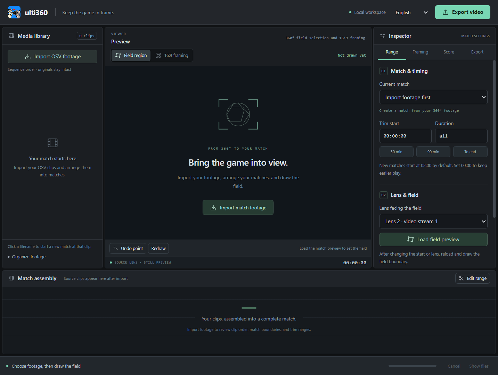

# ulti360

**Keep the game in frame. / 让画面跟上比赛。**

Turn fixed-sideline DJI 360 footage into match-by-match 16:9 videos.

将固定场边 DJI 360 素材，制作成一场一个的 16:9 比赛视频。

[Download 0.12.0 Beta / 下载测试版](https://github.com/stevensun1005/ulti360-downloads/releases/tag/v0.12.0-beta.2) · [Report an issue / 问题反馈](https://github.com/stevensun1005/ulti360-downloads/issues)

## English

### Latest Windows and Mac downloads

**0.12.0 Beta 2 · Free for noncommercial use under the included license.** This repository provides packaged apps and usage information; the development repository remains private.

| Platform | Download | Install |
|---|---|---|
| Windows x64 | [Windows portable ZIP](https://github.com/stevensun1005/ulti360-downloads/releases/download/v0.12.0-beta.2/ulti360-Windows.zip) | Extract the complete folder and open `ulti360.exe`. Keep its `resources` folder beside the EXE. |
| Apple Silicon, macOS 13+ | [Mac arm64 ZIP](https://github.com/stevensun1005/ulti360-downloads/releases/download/v0.12.0-beta.2/ulti360-macOS-arm64.zip) | Extract the ZIP and move the intact `ulti360.app` to local `/Applications`. Intel Macs are not supported. |

**Download an app ZIP from the table or Release assets.** GitHub's automatic “Source code” archives contain this download page, not the application. Python, Node, and Git are not required to run either packaged app. The Mac package is ad-hoc signed, not notarized; for a copy you trust, follow [Apple's per-app opening instructions](https://support.apple.com/en-ca/102445) if verification blocks launch. New or unsigned Windows apps may trigger Windows download-reputation warnings.

FFmpeg is built into both apps. You do not need to install it separately. Only the two app ZIPs above are needed to run ulti360; the other Release attachments are optional third-party source, license, and build materials.

### Your first match

1. Copy your original `.OSV` clips to a local disk. The intended setup is a fixed, raised camera near the sideline middle.
2. Import the day's clips. Up to 200 clips sort by trailing numeric `00xx`, independent of selection order. Review the sequence; manual controls handle numbering restarts.
3. Click each match's first filename to mark its start. A new match skips the first two minutes of its first clip when that clip lasts at least 2:01; edit **Trim start** or enter `00:00:00` to retain the opening. Later clips stay intact.
4. Choose the lens facing the field and draw 3–50 boundary points, excluding spectators and benches where possible. Redraw after a camera-position change.
5. Inspect the **16:9 framing** preview at Center, Left, and Right. Start with Natural wide at fixed 100°; 120° and narrower angles are available.
6. Choose a local output folder and export. Each match produces an MP4 and companion JSON. Try a short range before a full match.

Defaults are High quality, supersampled 1080p, 25 fps, Natural wide, fixed 100°, and Auto encoding. You can choose 720p, QHD/2K, UHD/4K, and 50 fps. A 25 fps source repeats frames at 50 fps. Source audio is included as AAC when available, and exports have a small lower-right ulti360 watermark. Windows Auto uses x264; Apple Silicon can use VideoToolbox and Core ML at supported stages. Processing runs on your computer.

### Scores and beta limitations

Optional score graphics use **reviewed entries**, such as `04:31 A`, measured from the trimmed exported match's start. For suggestions, A means light jerseys and B dark jerseys. Correct every suggested goal, add omissions, and confirm review before export. A known final score checks counts, not goal timing or team accuracy.

Tracking follows on-field people rather than detecting the disc. Grouping, field boundaries, and camera coverage need checking. Natural wide reduces stretching but does not restore missing optical detail. Current-version full-match/all-day qualification and independent automatic-score accuracy remain incomplete. The Mac and Windows 0.12.0 apps passed recorded native startup/layout checks; current-version long exports have not been newly qualified. Detailed validation is summarized in the Release notes.

### Support and license

[Report a problem](https://github.com/stevensun1005/ulti360-downloads/issues) with app version, OS/chip/GPU, error text, clip numbers/durations, and export settings. Typical logs are `%APPDATA%\ulti360\logs\ulti360.jsonl` on Windows and `~/Library/Application Support/ulti360/logs/ulti360.jsonl` on Mac; `electron_debug.log` sits in the adjacent user-data directory. Logs and JSON may contain local paths or team names; review before sharing. Do not post private footage or credentials.

Project-owned code and documentation use [PolyForm Noncommercial 1.0.0](LICENSE.md). Commercial use requires separate permission. Third-party components keep their own terms. Both apps provide matching FFmpeg/x264 and Electron/OpenCV FFmpeg source archives, build recipes, patches, license texts and SHA-256 records in the same Release. Mac in-process FFmpeg uses replaceable LGPL libraries. See [third-party notices and source delivery](THIRD-PARTY.md). Source checks are separate from recognition accuracy and Apple notarization.

## 中文

### Windows 与 Mac 最新下载

**0.12.0 Beta 2 测试版 · 按随包许可免费用于非商业用途。** 本仓库提供打包软件与使用说明，开发仓库继续保持私有。

| 平台 | 下载 | 安装 |
|---|---|---|
| Windows x64 | [Windows 便携 ZIP](https://github.com/stevensun1005/ulti360-downloads/releases/download/v0.12.0-beta.2/ulti360-Windows.zip) | 完整解压后打开 `ulti360.exe`，保留旁边的 `resources` 文件夹。 |
| M 芯片 Mac，macOS 13+ | [Mac arm64 ZIP](https://github.com/stevensun1005/ulti360-downloads/releases/download/v0.12.0-beta.2/ulti360-macOS-arm64.zip) | 解压，将完整 `ulti360.app` 放到本机 `/Applications`，不支持 Intel Mac。 |

**从上表或 Release 附件下载软件 ZIP。** GitHub 自动生成的 “Source code” 压缩包只包含本下载页，不包含应用。运行打包软件无需 Python、Node 或 Git。Mac 包为临时本机签名、未公证，可信副本被拦截时按 [Apple 单个应用打开说明](https://support.apple.com/en-ca/102445)操作。新发布或未签名的 Windows 软件可能出现下载信誉提示。

FFmpeg 已内置于两平台应用，无需单独安装。运行 ulti360 只需下载上表对应系统的软件 ZIP；Release 其他附件是供查阅或重建的第三方源码、许可和构建材料。

### 第一次制作比赛视频

1. 将原始 `.OSV` 复制到本机磁盘，推荐在场边中线附近固定、架高相机。
2. 导入当天素材，一次最多 200 段，按文件末尾 `00xx` 排序，不受选择顺序影响；核对顺序，编号重启时手动调整。
3. 点击每场首段文件名标记开场。首段至少 2:01 时，新场次默认跳过前两分钟；修改「剪辑起点」或填 `00:00:00` 可保留开头，后续分卷完整保留。
4. 选择面向球场的镜头，用 3–50 个点圈场，尽量排除观众与替补席；机位变化后重画。
5. 检查「16:9 取景」中、左、右预览，先用默认自然广角固定 100°，另可选 120° 或较窄角度。
6. 选择本机输出目录后导出，每场生成 MP4 和配套 JSON。整场前先试较短区间。

默认高画质、超采样 1080p、25 fps、自然广角固定 100°、自动编码。可选 720p、QHD/2K、UHD/4K 与 50 fps；25 fps 原片导出 50 fps 会重复帧。有原始音轨时输出 AAC，每段视频带右下角小型 ulti360 水印。Windows 自动编码用 x264，M 芯片可在支持的阶段使用 VideoToolbox 和 Core ML，视频在你的电脑上处理。

### 比分与测试版范围

可选比分图形使用**复核后的记录**，例如 `04:31 A`，时间从剪裁后成片起点算起。建议分析时 A 为浅色、B 为深色球衣队。逐条修正、补漏并确认复核后再输出；终场比分只检查数量，不证明时间或队伍正确。

取景跟随场内人员，不识别飞盘本体；分场、圈场和覆盖范围都需检查。自然广角能减少拉伸，不能补回缺失光学细节。当前版本的整场/整日验证和独立自动判分准确率尚未完成。两平台 0.12.0 已记录本机启动与布局检查，当前版本长片尚未重新完成验证，详情见 Release 说明。

### 支持与许可

[反馈问题](https://github.com/stevensun1005/ulti360-downloads/issues) 时说明版本、系统/芯片/显卡、错误原文、片段编号/时长和输出设置。常见日志为 Windows 的 `%APPDATA%\ulti360\logs\ulti360.jsonl`，Mac 的 `~/Library/Application Support/ulti360/logs/ulti360.jsonl`，`electron_debug.log` 位于相邻用户数据目录。日志和 JSON 可能含本地路径、队名，分享前检查，不公开私人原片或密钥。

项目自有代码与文档使用 [PolyForm Noncommercial 1.0.0](LICENSE.md)，商业用途需单独授权。第三方组件保留各自条款；两平台在同一 Release 提供匹配的 FFmpeg/x264 与 Electron/OpenCV FFmpeg 源码、构建脚本、补丁、许可原文和 SHA-256；Mac 进程内使用可替换 LGPL 库，见[第三方通知与源码交付](THIRD-PARTY.md)。源码核对与识别准确率、Apple 公证是不同事项。
