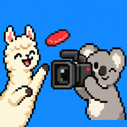
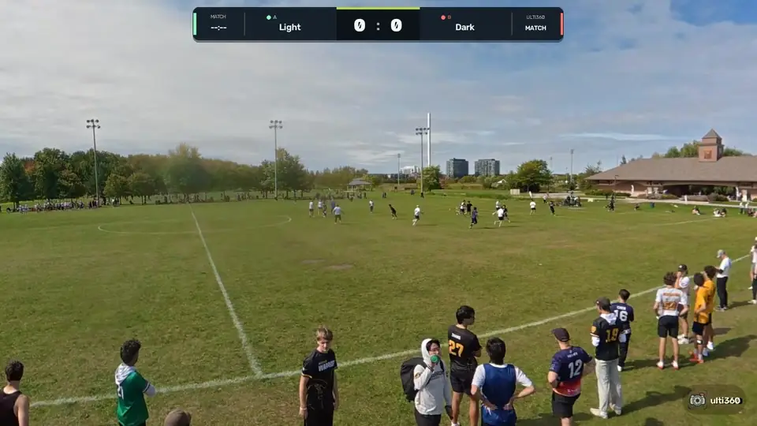
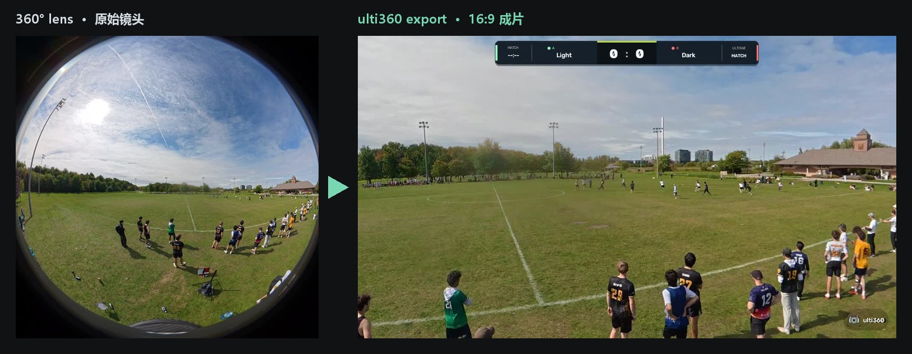
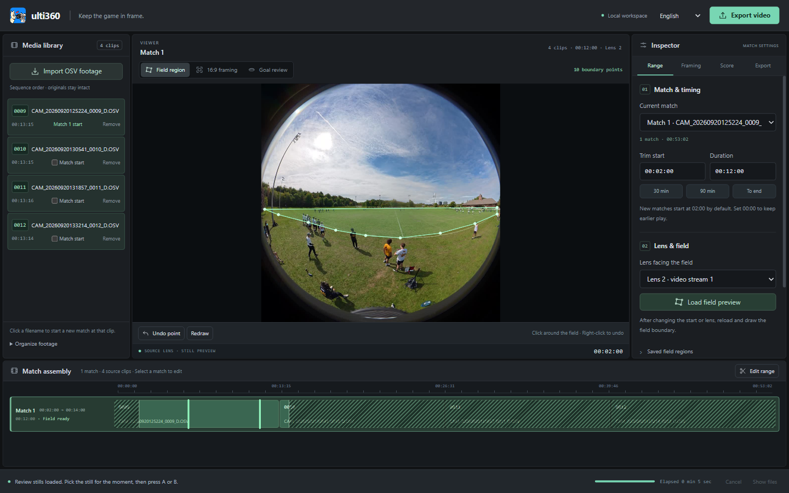
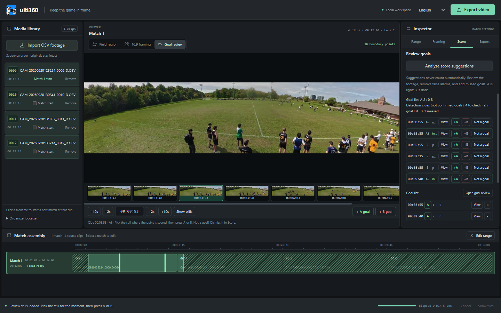

# ulti360

### 场边一台 360° 相机，每场比赛都是转播级视频。

把一整天的 DJI 360 素材，变成跟着比赛走的 16:9 飞盘视频， 比分、计时和得分动画自动叠加。全部在你的电脑上完成。

[English](README.md) · **简体中文**

<h3>
  <a href="https://github.com/stevensun1005/ulti360-downloads/releases/download/v0.13.1-beta.1/ulti360-Windows.zip">⬇️ 下载 Windows 版</a>
  &nbsp;·&nbsp;
  <a href="https://github.com/stevensun1005/ulti360-downloads/releases/download/v0.13.1-beta.1/ulti360-macOS-arm64.zip">⬇️ 下载 Mac 版</a>
</h3>

真实导出、未经剪辑：360° 素材由 ulti360 自动取景、跟随比赛，并叠加比分与得分动画。

---

## ✨ 为什么选 ulti360

<table>
<tr>
<td width="33%" valign="top">

### 🎥 架好就去打
一台架高的 360° 相机放在中线，整片场地尽收眼底。不用摄像师，不漏任何一球。

</td>
<td width="33%" valign="top">

### 🧭 自动跟拍
根据场上人员的位置和移动，平稳转动自然广角的 16:9 画面，不乱变焦、不晃眼。

</td>
<td width="33%" valign="top">

### 🏆 转播级比分条
队名、比赛计时和得分动画；每一分按一个键确认即可。

</td>
</tr>
<tr>
<td valign="top">

### 📅 一天素材一次搞定
一次导入最多 200 段，点一下标出每场开头，自动一场一个视频。

</td>
<td valign="top">

### 🔒 素材只在你手里
全程在本机处理，不上传、不注册账号。

</td>
<td valign="top">

### 📊 直接接入球队数据
每次导出附带包含已确认得分的比赛文件，可导入球队数据应用 [UltiZ](#-013-新功能)。

</td>
</tr>
</table>

## 🔥 前后对比

## 🚀 四步做出第一场比赛

| | 步骤 | 你要做的 |
|:-:|---|---|
| 1️⃣ | **导入** | 拖入当天的 `.OSV`，按片段编号自动排序。 |
| 2️⃣ | **分场** | 点每场的第一段。默认跳过开头两分钟，留给架设三脚架。 |
| 3️⃣ | **圈场地** | 在朝向比赛的镜头上沿场地边界点几下，再预览 16:9 画面。 |
| 4️⃣ | **导出** | 选一个文件夹，每场生成独立 MP4，直接传 YouTube。 |

## 🆕 0.13 新功能

- 🥏 **得分复核**：跳到任意时刻，看前后八张全场画面，按 **A** 或 **B** 记分；建议的得分一点就开，不用再去别的播放器里找时间。
- 📐 **场地校准**（可选）：点四个场角和两条端区线，得到以米为单位的场地坐标。
- 📊 **UltiZ 比赛文件**：每次导出附带 `.ultiz.json`，包含已确认的得分、得分方和计时。
- 🗄️ **支持 NAS**（0.13.1）：从映射网络驱动器导入，时长正常显示。

## 📦 下载

| 平台 | 版本 | 下载 | 安装 |
|---|---|---|---|
| **Windows** x64 | 0.13.1 测试版 | [**ulti360-Windows.zip**](https://github.com/stevensun1005/ulti360-downloads/releases/download/v0.13.1-beta.1/ulti360-Windows.zip) | 完整解压后打开 `ulti360.exe`，保留旁边的 `resources` 文件夹。 |
| **Mac** M 芯片，macOS 13+ | 0.13.1 测试版 | [**ulti360-macOS-arm64.zip**](https://github.com/stevensun1005/ulti360-downloads/releases/download/v0.13.1-beta.1/ulti360-macOS-arm64.zip) | 解压后将 `ulti360.app` 移到 `/Applications`，不支持 Intel Mac。 |

两个平台均为同一 0.13.1 版本。无需安装 Python、Node 或 FFmpeg。请下载上表的软件 ZIP，GitHub 自动生成的 “Source code” 只包含本页面。Mac 版为临时签名、未公证，被拦截时按 [Apple 打开应用说明](https://support.apple.com/zh-cn/102445)操作；新软件在 Windows 上可能出现下载提示。

## 🎬 拍摄小贴士

- **越高越好**：在中线尽量把相机架高，球员互相遮挡更少。
- **开盘前就开始录**：每场默认跳过前两分钟；需要保留时把「剪辑起点」设为 `00:00:00`。
- **两队球衣颜色反差大**，得分建议更容易分清队伍：A 为浅色，B 为深色。
- **先导出一小段**，检查覆盖范围、清晰度和声音。

## ❓ 常见问题

<b>支持哪些相机？</b>
 录制双镜头 <code>.OSV</code> 文件的 DJI 360 相机。相机固定、架高在一侧边线中间附近。

<b>比分是自动的吗？</b>
 ulti360 会根据人员移动<i>建议</i>得分，每一分都要你在「得分复核」里确认后才会显示。软件看不到飞盘、无法判断接盘是否合法，最终比分永远以你的复核为准。

<b>会追踪飞盘吗？</b>
 不会。画面跟随场上人员的分布和移动，不识别飞盘本身也能让比赛留在画面里。

<b>需要联网或注册吗？</b>
 不需要，视频全部在你的电脑上处理。

<b>能导出什么规格？</b>
 默认 1080p，另有 720p、2K、4K，25 或 50 fps。每段视频右下角带一个小的 ulti360 水印。

<b>俱乐部或收费拍摄能用吗？</b>
 可以。从 0.13 起采用 <a href="LICENSE-ulti360.md">ulti360 许可</a>，官方版本可用于任何用途，包括商业用途；再分发、修改和去除水印需另行授权。0.12.0 及更早版本保留 <a href="LICENSE.md">PolyForm Noncommercial</a>。

<b>遇到问题去哪里反馈？</b>
 <a href="https://github.com/stevensun1005/ulti360-downloads/issues">提交 Issue</a>，写明软件版本、系统/芯片、错误原文和片段编号。日志位于 <code>%APPDATA%\ulti360\logs\ulti360.jsonl</code>（Windows）或 <code>~/Library/Application Support/ulti360/logs/ulti360.jsonl</code>（Mac）。分享前检查其中的路径和队名，不要公开私人原片。

## 📜 许可与第三方软件

ulti360 0.13 及之后：[ulti360 许可](LICENSE-ulti360.md)；0.12.0 及更早：[PolyForm Noncommercial 1.0.0](LICENSE.md)。FFmpeg、x264、Electron、OpenCV、ONNX Runtime 与 YOLOX 适用各自条款，每个 Release 都附带对应的 FFmpeg 源码与构建记录，详见[第三方通知](THIRD-PARTY.md)。

---

**如果 ulti360 帮到了你的球队，⭐ 点个 Star，晒出你们的比赛视频吧。**

为飞盘队伍打造 · Windows 与 Apple Silicon · 中文 / English

